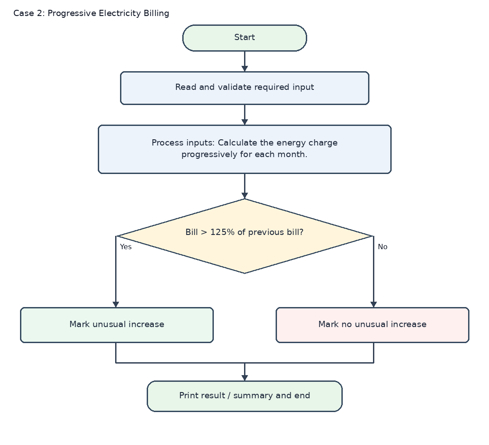

# Case 2: Progressive Electricity Billing

**Student:** J NAGA DHARMA TEJA  
**Roll number:** 26000505

## Problem statement

Calculate household bills with consumption slabs, fixed charges, surcharges and rebates. Compare monthly bills and identify unusual increases.

## Objectives

- Calculate a progressive bill for each month.
- Compare consecutive bills and report unusually large increases.

## Assumptions and rules

- Monthly units must be non-negative whole numbers.
- First 100 units cost Rs 3 each, next 100 Rs 5 each and units above 200 Rs 7 each.
- Fixed charge is Rs 50. Add 10% of energy charge as surcharge if units exceed 300. Give a Rs 20 rebate if units are at most 100.
- An increase over 25% from the previous bill is unusual; equality is not unusual. All amounts are in rupees.
- Numeric prompts expect numeric input in the requested format; non-numeric input is outside these examples.

## Algorithm

1. Read the number of months and the units for each month.
2. Calculate the energy charge progressively for each month.
3. Add the fixed charge and applicable surcharge, then subtract the rebate.
4. Print each bill and compare it with the preceding month.

## Flowchart



The chart is a high-level view; validation and repeated processing are detailed in the algorithm and pseudocode.

## Pseudocode

```text
READ number of months
FOR each month
  READ units
  CALCULATE energy charge using slabs
  ADD fixed charge and any surcharge
  SUBTRACT applicable rebate
  IF previous bill exists AND current > previous * 1.25
    REPORT unusual increase
  PRINT bill
END FOR
```

## Python source code

See [solution.py](solution.py). Run from this folder with `python solution.py` and enter the requested values.

## Test cases and output screenshots

### Test 1: Slabs, rebate and increase

Input, one value per line:
```text
3
100
200
301
```
Expected checks: `Month 1 bill: Rs 330.00`; `Month 2 bill: Rs 850.00`; `Month 3 bill: Rs 1707.70`; `Unusual increase`.

Actual output: [text](output-1.txt) | [output image](output-1.png).

### Test 2: Invalid units

Input, one value per line:
```text
1
-2
```
Expected checks: `Units cannot be negative`.

Actual output: [text](output-2.txt) | [output image](output-2.png).

The output images are rendered from the actual captured program runs; inputs are shown separately because piped input is not echoed by the program.

## Conclusion

This program demonstrates progressive electricity billing using the stated rules. The tests cover the main scenario and at least one additional or boundary condition. Different institutional rules can be substituted if required.
