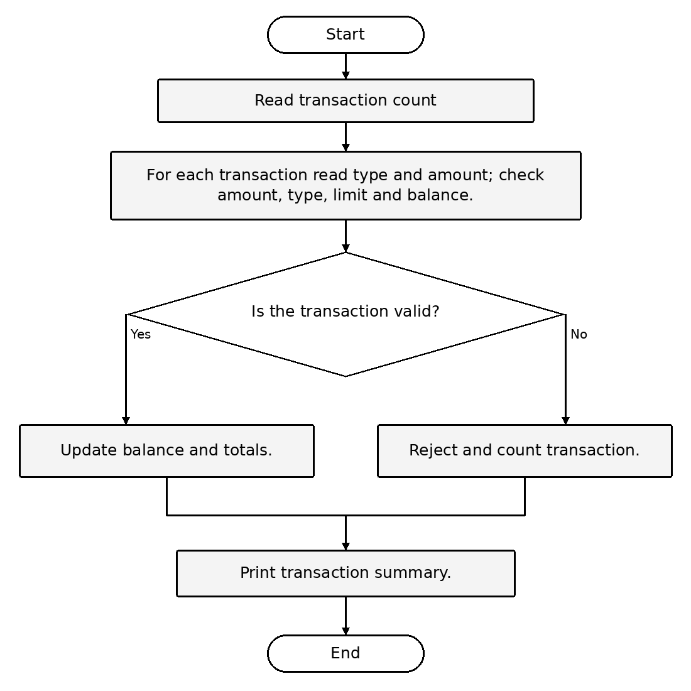

# Case 13: ATM Transaction Sequence Simulation

## Problem statement

Process deposits and withdrawals, maintain a simulated balance, enforce withdrawal limits, reject invalid transactions and produce a summary.

## Objectives

- Update a balance for a sequence of transactions.
- Reject invalid transactions and show totals.

## Assumptions

- Opening balance is Rs 1,000.
- Amounts must be positive, finite numbers with at most two decimal places; the withdrawal limit is Rs 5,000 per transaction and withdrawal cannot exceed the balance.
- Transaction type is D for deposit or W for withdrawal, without regard to case. Rejected operations do not change the balance.
- Numeric input must be entered in the requested format.

## Algorithm

1. Start with the opening balance and zero totals.
2. Read each type and amount.
3. Check type, amount, decimal places, balance and withdrawal limit.
4. Apply valid transactions, count rejections and print the summary.

## Flowchart



## Pseudocode

```text
SET balance to 1000
READ number of transactions
FOR every transaction
  READ type and amount
  IF valid deposit: add to balance and deposit total
  ELSE IF valid withdrawal: subtract and add to withdrawal total
  ELSE: count rejection
  PRINT result
PRINT balance, totals and rejection count
```

## Python source code

[solution.py](solution.py)

## Test cases

1. **Valid and rejected transactions**

   Input (one value per line):

   ```text
3
D
500
W
1200
W
400
   ```

   Expected: `Deposits: Rs 500.00`; `Withdrawals: Rs 1200.00`; `Rejected: 1`; `Balance: Rs 300.00`.

2. **Limit and invalid amount**

   Input (one value per line):

   ```text
2
W
6000
D
0
   ```

   Expected: `Rejected: 2`; `Balance: Rs 1000.00`.

3. **Non-finite and extra decimal amounts**

   Input (one value per line):

   ```text
3
D
nan
D
inf
D
1.234
   ```

   Expected: `Rejected: 3`; `Balance: Rs 1000.00`.

4. **Withdraw available balance**

   Input (one value per line):

   ```text
1
W
1000
   ```

   Expected: `Withdrawal accepted`; `Balance: Rs 0.00`.

## Output screenshots

- Test 1: [output image](output-1.png) | [output text](output-1.txt)
- Test 2: [output image](output-2.png) | [output text](output-2.txt)
- Test 3: [output image](output-3.png) | [output text](output-3.txt)
- Test 4: [output image](output-4.png) | [output text](output-4.txt)

The images are made from actual captured program output; input is shown separately.

## Conclusion

The program solves this case using the rules and conditions stated above.
