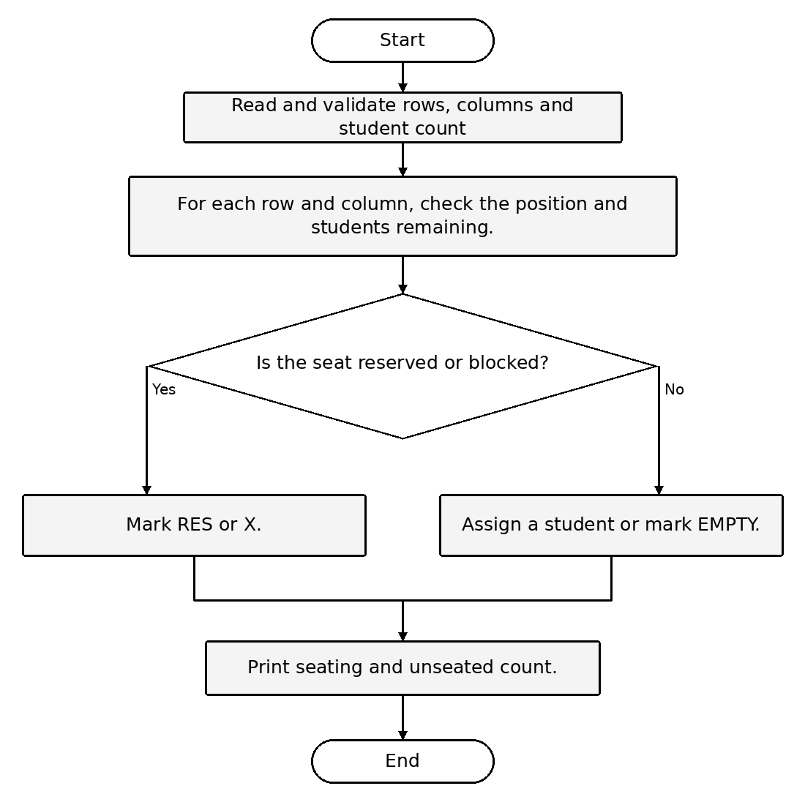

# Case 26: Nested Loop Examination Seating Generator

## Problem statement

Generate an examination seating arrangement using row and column identifiers, reserved positions, alternate seating restrictions and fixed classroom capacity.

## Objectives

- Generate a row-by-column seating plan.
- Respect reserved positions and alternating-seat rules.

## Assumptions

- A classroom has a maximum of 5 rows and 6 columns.
- Rows and columns are numbered from 1. The seat at row 1, column 1 is reserved.
- Only positions with an even row-plus-column sum are allowed for students; the reserved position takes priority.
- Students are assigned sequential identifiers S01, S02 and so on. Extra students remain unseated.
- Numeric input must be entered in the requested format.

## Algorithm

1. Read rows, columns and student count and validate limits.
2. Use nested loops to visit every seat.
3. Mark the reserved seat first, then block alternating seats, then assign available students.
4. Print the arrangement and number of students still unseated.

## Flowchart



## Pseudocode

```text
READ rows, columns, students
IF dimensions or student count are invalid: STOP
FOR each row
  FOR each column
    IF reserved position: mark RES
    ELSE IF row + column is odd: mark X
    ELSE IF students remain: assign next student
    ELSE: mark EMPTY
  PRINT row
PRINT unseated count
```

## Python source code

[solution.py](solution.py)

## Test cases

1. **More students than available seats**

   Input (one value per line):

   ```text
2
3
4
   ```

   Expected: `R1C1:RES  R1C2:X  R1C3:S01`; `R2C1:X  R2C2:S02  R2C3:X`; `Unseated: 2`.

2. **Invalid room size**

   Input (one value per line):

   ```text
6
2
3
   ```

   Expected: `Invalid dimensions`.

3. **Smallest room**

   Input (one value per line):

   ```text
1
1
1
   ```

   Expected: `R1C1:RES`; `Assigned: 0`; `Unseated: 1`.

## Output screenshots

- Test 1: [output image](output-1.png) | [output text](output-1.txt)
- Test 2: [output image](output-2.png) | [output text](output-2.txt)
- Test 3: [output image](output-3.png) | [output text](output-3.txt)

The images are made from actual captured program output; input is shown separately.

## Conclusion

The program solves this case using the rules and conditions stated above.
