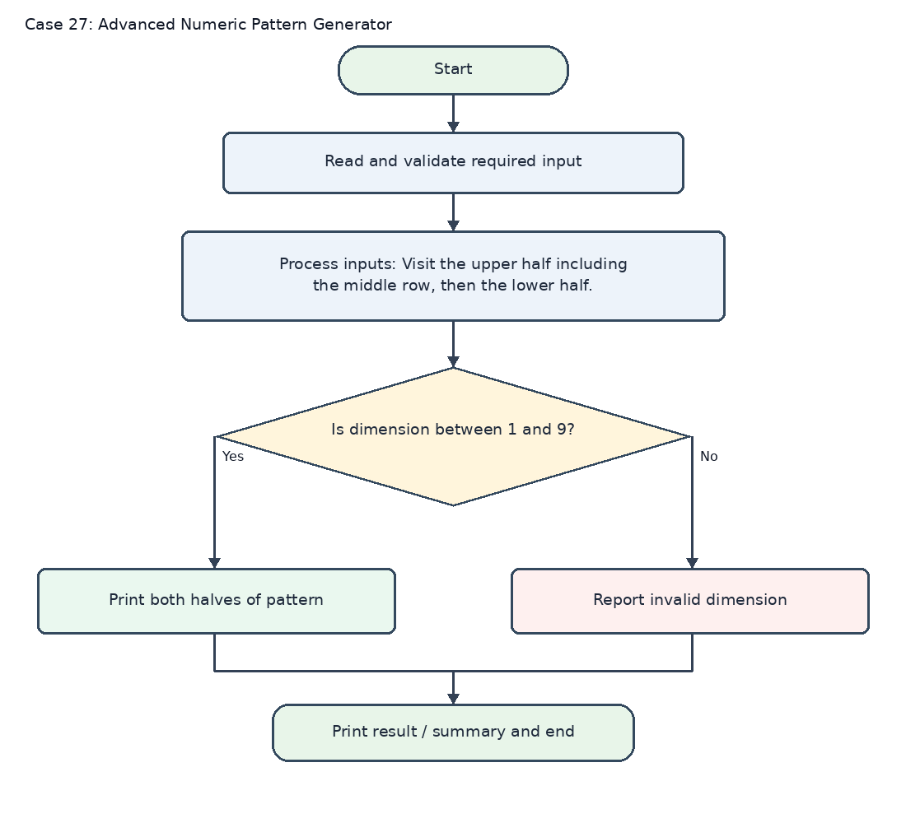

# Case 27: Advanced Numeric Pattern Generator

**Student:** J NAGA DHARMA TEJA  
**Roll number:** 26000505

## Problem statement

Produce a symmetric numerical pattern for a user-specified dimension, validating invalid dimensions and aligning the output.

## Objectives

- Use nested loops to make a symmetric numeric diamond.
- Reject dimensions outside the chosen range.

## Assumptions and rules

- Dimension is an integer from 1 to 9 and represents the largest number in the middle row.
- Each row ascends to its row number and descends to 1; leading spaces align the diamond.
- Numeric prompts expect numeric input in the requested format; non-numeric input is outside these examples.

## Algorithm

1. Read and validate the dimension.
2. Visit the upper half including the middle row, then the lower half.
3. For each row, print leading spaces, ascending numbers and descending numbers.

## Flowchart



The chart is a high-level view; validation and repeated processing are detailed in the algorithm and pseudocode.

## Pseudocode

```text
READ n
IF n is outside 1 to 9: REPORT invalid
ELSE
  FOR line from 1 to 2*n-1
    FIND row number (increasing then decreasing)
    ADD leading spaces
    ADD numbers from 1 to row number
    ADD numbers from row number-1 down to 1
    PRINT line
```

## Python source code

See [solution.py](solution.py). Run from this folder with `python solution.py` and enter the requested values.

## Test cases and output screenshots

### Test 1: Diamond of size 3

Input, one value per line:
```text
3
```
Expected checks: `    1 /   1 2 1 / 1 2 3 2 1 /   1 2 1 /     1`.

Actual output: [text](output-1.txt) | [output image](output-1.png).

### Test 2: Invalid dimension

Input, one value per line:
```text
0
```
Expected checks: `Invalid dimension`.

Actual output: [text](output-2.txt) | [output image](output-2.png).

The output images are rendered from the actual captured program runs; inputs are shown separately because piped input is not echoed by the program.

## Conclusion

This program demonstrates advanced numeric pattern generator using the stated rules. The tests cover the main scenario and at least one additional or boundary condition. Different institutional rules can be substituted if required.
