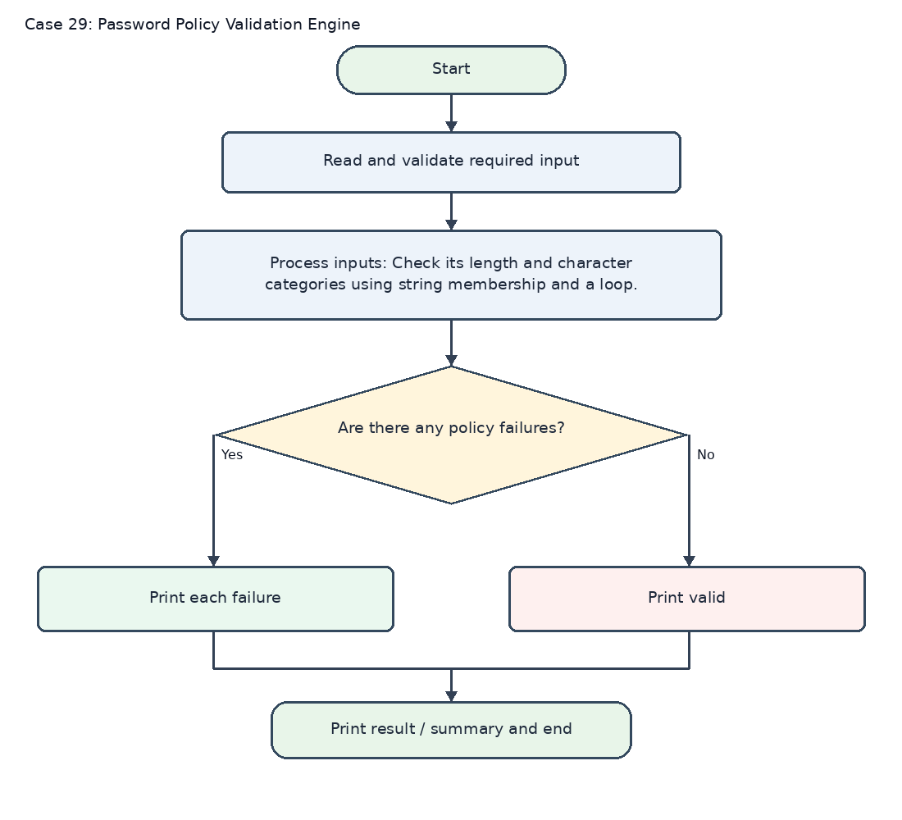

# Case 29: Password Policy Validation Engine

**Student:** J NAGA DHARMA TEJA  
**Roll number:** 26000505

## Problem statement

Evaluate password strings against minimum length, character categories, repetition and prohibited substrings, and explain every failed condition.

## Objectives

- Check each password against a stated policy.
- Print all reasons a password fails.

## Assumptions and rules

- Minimum length is 8 characters. At least one ASCII uppercase letter, lowercase letter, digit and one of !@#$% is required.
- Three identical consecutive characters are not allowed. The substring password is prohibited regardless of case.
- This is a classroom policy checker, not a secure password storage system.
- Numeric prompts expect numeric input in the requested format; non-numeric input is outside these examples.

## Algorithm

1. Read a password.
2. Check its length and character categories using string membership and a loop.
3. Check consecutive repeated characters and prohibited substring.
4. Print all failures or print that it is valid.

## Flowchart



The chart is a high-level view; validation and repeated processing are detailed in the algorithm and pseudocode.

## Pseudocode

```text
READ password
CHECK length and four character categories
CHECK any three consecutive equal characters
CHECK prohibited substring ignoring case
IF no failures: PRINT valid
ELSE: PRINT each failure
```

## Python source code

See [solution.py](solution.py). Run from this folder with `python solution.py` and enter the requested values.

## Test cases and output screenshots

### Test 1: Valid password

Input, one value per line:
```text
Abc123!x
```
Expected checks: `Valid password`.

Actual output: [text](output-1.txt) | [output image](output-1.png).

### Test 2: Multiple failures

Input, one value per line:
```text
passwordaaa
```
Expected checks: `Invalid password`; `Uppercase letter required`; `Digit required`; `Special character`; `Three identical`; `Prohibited substring`.

Actual output: [text](output-2.txt) | [output image](output-2.png).

The output images are rendered from the actual captured program runs; inputs are shown separately because piped input is not echoed by the program.

## Conclusion

This program demonstrates password policy validation engine using the stated rules. The tests cover the main scenario and at least one additional or boundary condition. Different institutional rules can be substituted if required.
