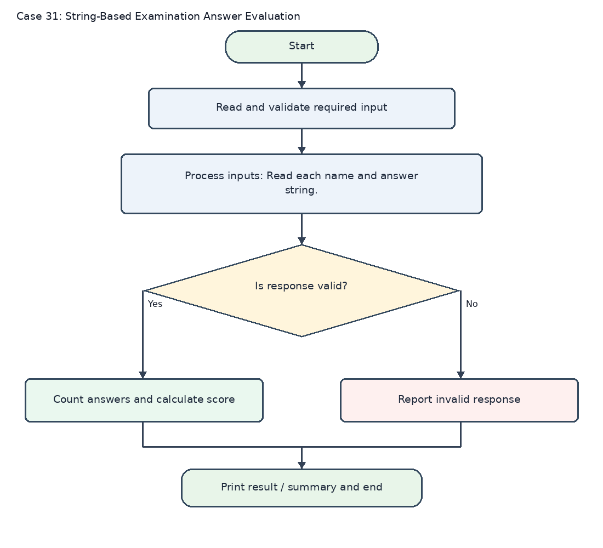

# Case 31: String-Based Examination Answer Evaluation

**Student:** J NAGA DHARMA TEJA  
**Roll number:** 26000505

## Problem statement

Compare answer strings with an answer key, count correct, incorrect and unanswered responses, apply negative marking and show results.

## Objectives

- Evaluate multiple students against one key.
- Calculate the total using negative marks.

## Assumptions and rules

- The key uses uppercase A, B, C or D only; responses use those letters or - for unanswered.
- Each correct answer gives 4 marks, each incorrect answer deducts 1, and unanswered answers give 0. Negative totals are allowed.
- A response must be the same length as the key. Input is converted to uppercase.
- Numeric prompts expect numeric input in the requested format; non-numeric input is outside these examples.

## Algorithm

1. Read and validate the key and student count.
2. Read each name and answer string.
3. Check the length and permitted symbols.
4. Compare each answer with the key, count categories and print the score.

## Flowchart



The chart is a high-level view; validation and repeated processing are detailed in the algorithm and pseudocode.

## Pseudocode

```text
READ key and count
IF key or count is invalid: STOP
FOR each student
  READ name and response
  IF response invalid: REPORT and continue
  COUNT correct, incorrect and unanswered
  score = correct * 4 - incorrect
  PRINT counts and score
```

## Python source code

See [solution.py](solution.py). Run from this folder with `python solution.py` and enter the requested values.

## Test cases and output screenshots

### Test 1: Mixed answers and invalid record

Input, one value per line:
```text
ABCD
2
Ravi
AB-D
Anu
AXCD
```
Expected checks: `Ravi Correct: 3 Incorrect: 0 Unanswered: 1 Score: 12`; `Invalid response for Anu`.

Actual output: [text](output-1.txt) | [output image](output-1.png).

### Test 2: Negative marks

Input, one value per line:
```text
AA
1
Kiran
BB
```
Expected checks: `Correct: 0 Incorrect: 2 Unanswered: 0 Score: -2`.

Actual output: [text](output-2.txt) | [output image](output-2.png).

The output images are rendered from the actual captured program runs; inputs are shown separately because piped input is not echoed by the program.

## Conclusion

This program demonstrates string-based examination answer evaluation using the stated rules. The tests cover the main scenario and at least one additional or boundary condition. Different institutional rules can be substituted if required.
