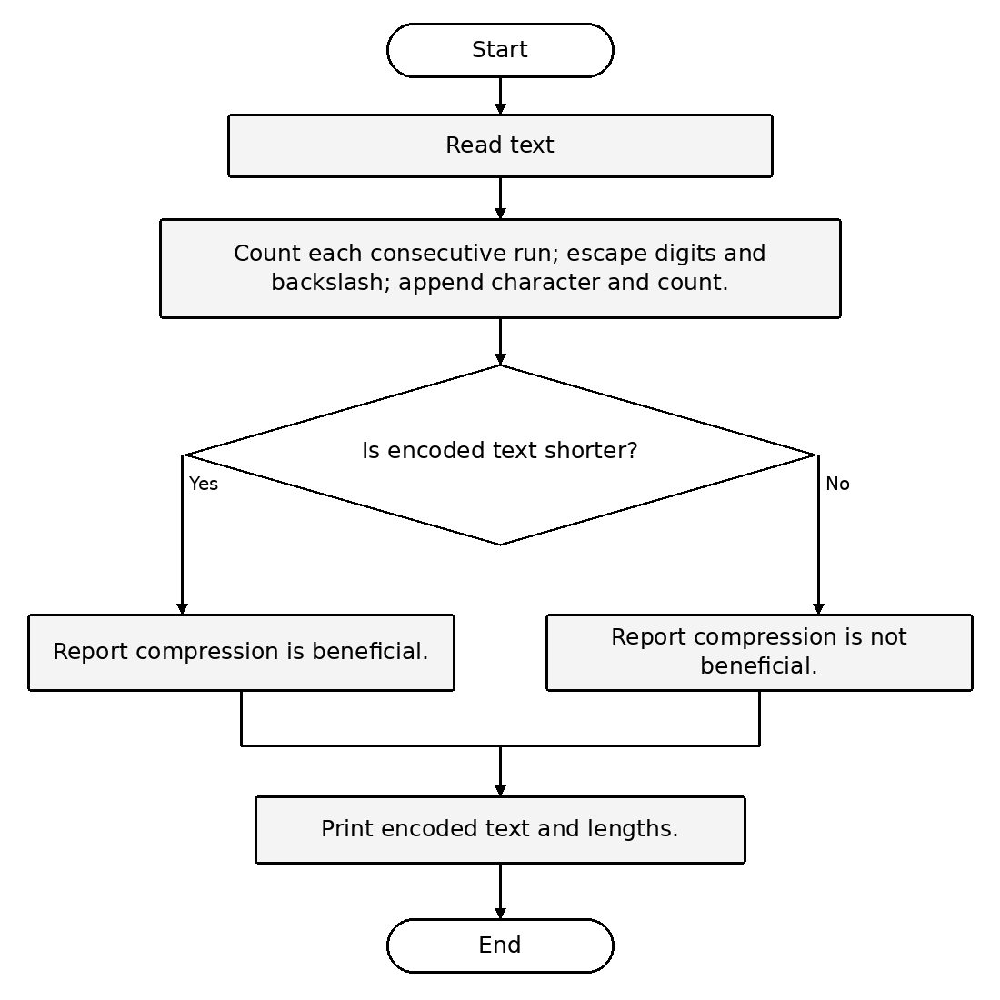

# Case 35: Text Compression Using Character Runs

## Problem statement

Encode a string by grouping consecutive repeated characters and compare the original and encoded lengths, including cases where encoding is not beneficial.

## Objectives

- Group consecutive identical characters.
- Compare the encoded and original lengths.

## Assumptions

- Runs are encoded as character followed by its decimal count, for example AAABB becomes A3B2.
- Counts are included even for a single character; spaces and digits are counted as characters too.
- To avoid ambiguity, a digit or a backslash used as a character is prefixed with a backslash. Empty input is allowed.

## Algorithm

1. Read the text.
2. Traverse the text while counting each consecutive character run.
3. Escape digits and backslashes, then append the character and its count to the encoded string.
4. Compare lengths and say whether encoding saves space.

## Flowchart



## Pseudocode

```text
READ text
SET encoded to empty
WHILE characters remain
  COUNT identical consecutive characters
  IF character is a digit or backslash: APPEND backslash
  APPEND character and count
PRINT encoded and both lengths
IF encoded length < original length: report saving
ELSE: report not beneficial
```

## Python source code

[solution.py](solution.py)

## Test cases

1. **Repeated characters**

   Input (one value per line):

   ```text
AAAABBBCC
   ```

   Expected: `Encoded: A4B3C2`; `Original length: 9`; `Encoded length: 6`; `Compression is beneficial`.

2. **Non-repeating characters**

   Input (one value per line):

   ```text
ABC
   ```

   Expected: `Encoded: A1B1C1`; `Original length: 3`; `Encoded length: 6`; `Compression is not beneficial`.

3. **Empty text**

   Input (one value per line):

   ```text
(empty line)
   ```

   Expected: `Original length: 0`; `Encoded length: 0`; `Compression is not beneficial`.

4. **Digits and backslashes are escaped**

   Input (one value per line):

   ```text
AA11\\
   ```

   Expected: `Encoded: A2\12\\2`; `Original length: 6`; `Encoded length: 8`.

## Output screenshots

- Test 1: [output image](output-1.png) | [output text](output-1.txt)
- Test 2: [output image](output-2.png) | [output text](output-2.txt)
- Test 3: [output image](output-3.png) | [output text](output-3.txt)
- Test 4: [output image](output-4.png) | [output text](output-4.txt)

The images are made from actual captured program output; input is shown separately.

## Conclusion

The program solves this case using the rules and conditions stated above.
