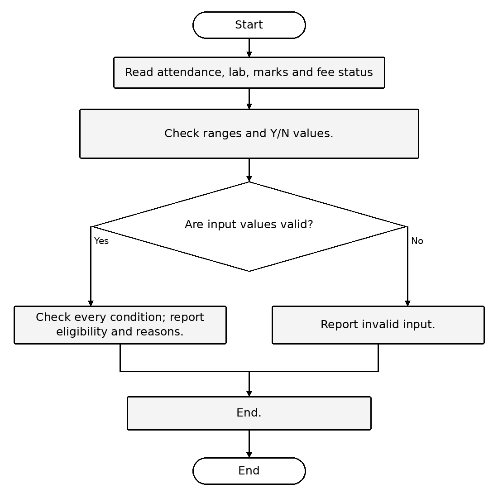

# Case 39: Multi-Stage Examination Eligibility System

## Problem statement

Determine final examination eligibility using attendance, laboratory completion, internal assessment and fee clearance, reporting every unmet requirement.

## Objectives

- Evaluate all four requirements.
- List each unmet condition instead of stopping at the first.

## Assumptions

- Attendance must be a finite number between 0 and 100 and at least 75%.
- Laboratory completion and fee clearance must be Y or N. Internal marks must be from 0 to 40, with at least 16 required.
- All four conditions must be met. Invalid input values are reported separately from an eligibility decision.
- Numeric input must be entered in the requested format.

## Algorithm

1. Read attendance, laboratory status, internal marks and fee status.
2. Validate the input ranges and Y/N choices.
3. Check each requirement independently and collect all reasons.
4. Print eligible if no requirement is missing, otherwise print all reasons.

## Flowchart



## Pseudocode

```text
READ attendance, lab status, internal marks, fee status
IF values are invalid: report invalid
ELSE
  CHECK each requirement and record failures
  IF no failures: report eligible
  ELSE: report every failure
```

## Python source code

[solution.py](solution.py)

## Test cases

1. **All conditions met at boundary**

   Input (one value per line):

   ```text
75
Y
16
Y
   ```

   Expected: `Eligible for final examination`.

2. **All conditions fail**

   Input (one value per line):

   ```text
74
N
15
N
   ```

   Expected: `Not eligible`; `Attendance below`; `Laboratory not completed`; `Internal marks below`; `Fees not cleared`.

3. **Invalid range**

   Input (one value per line):

   ```text
101
Y
20
Y
   ```

   Expected: `Invalid input values`.

4. **Non-finite attendance**

   Input (one value per line):

   ```text
nan
Y
20
Y
   ```

   Expected: `Invalid input values`.

## Output screenshots

- Test 1: [output image](output-1.png) | [output text](output-1.txt)
- Test 2: [output image](output-2.png) | [output text](output-2.txt)
- Test 3: [output image](output-3.png) | [output text](output-3.txt)
- Test 4: [output image](output-4.png) | [output text](output-4.txt)

The images are made from actual captured program output; input is shown separately.

## Conclusion

The program solves this case using the rules and conditions stated above.
