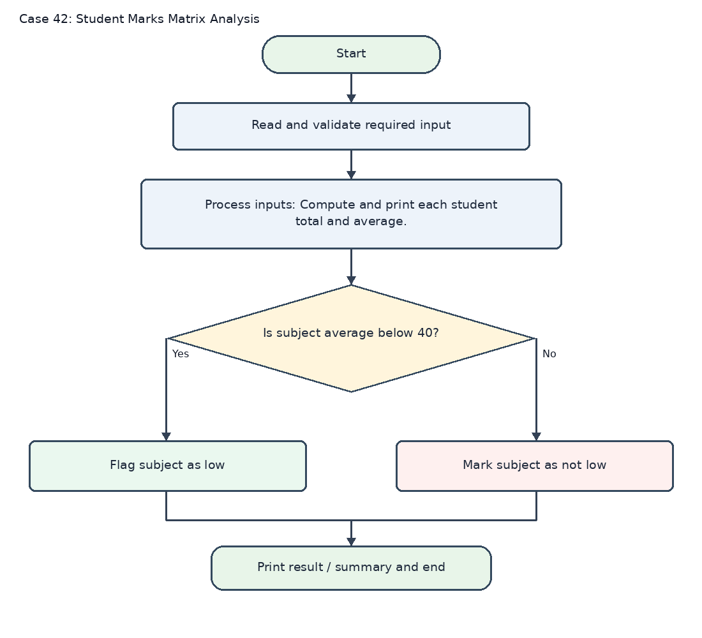

# Case 42: Student Marks Matrix Analysis

**Student:** J NAGA DHARMA TEJA  
**Roll number:** 26000505

## Problem statement

Analyse a matrix of student marks across subjects, calculate row-wise and column-wise statistics, identify top performers and detect subjects with low average performance.

## Objectives

- Calculate each student total and average.
- Calculate subject averages and identify all tied top performers and weak subjects.

## Assumptions and rules

- Enter at least one student and one subject; marks are numeric from 0 to 100.
- Student labels are S1, S2, ... and subject labels are Subject 1, Subject 2, ....
- A subject is low performing when its class average is below 40. Top performers are students with the highest total, including ties.
- Numeric prompts expect numeric input in the requested format; non-numeric input is outside these examples.

## Algorithm

1. Read matrix dimensions and student-wise marks, validating the range.
2. Compute and print each student total and average.
3. Find the maximum total and print all students with that total.
4. Compute every subject average and flag those below 40.

## Flowchart



The chart is a high-level view; validation and repeated processing are detailed in the algorithm and pseudocode.

## Pseudocode

```text
READ student and subject counts
READ matrix and validate every mark
FOR each student: calculate total and average
FIND maximum total and print all matching students
FOR each subject: calculate average
  IF average < 40: mark low
```

## Python source code

See [solution.py](solution.py). Run from this folder with `python solution.py` and enter the requested values.

## Test cases and output screenshots

### Test 1: Tied students and low subject

Input, one value per line:
```text
2
2
80
20
70
30
```
Expected checks: `S1 total: 100.00 average: 50.00`; `Top performer: S1`; `Top performer: S2`; `Subject 2 average: 25.00 LOW`.

Actual output: [text](output-1.txt) | [output image](output-1.png).

### Test 2: Invalid mark

Input, one value per line:
```text
1
1
101
```
Expected checks: `Invalid mark: use 0 to 100`.

Actual output: [text](output-2.txt) | [output image](output-2.png).

The output images are rendered from the actual captured program runs; inputs are shown separately because piped input is not echoed by the program.

## Conclusion

This program demonstrates student marks matrix analysis using the stated rules. The tests cover the main scenario and at least one additional or boundary condition. Different institutional rules can be substituted if required.
