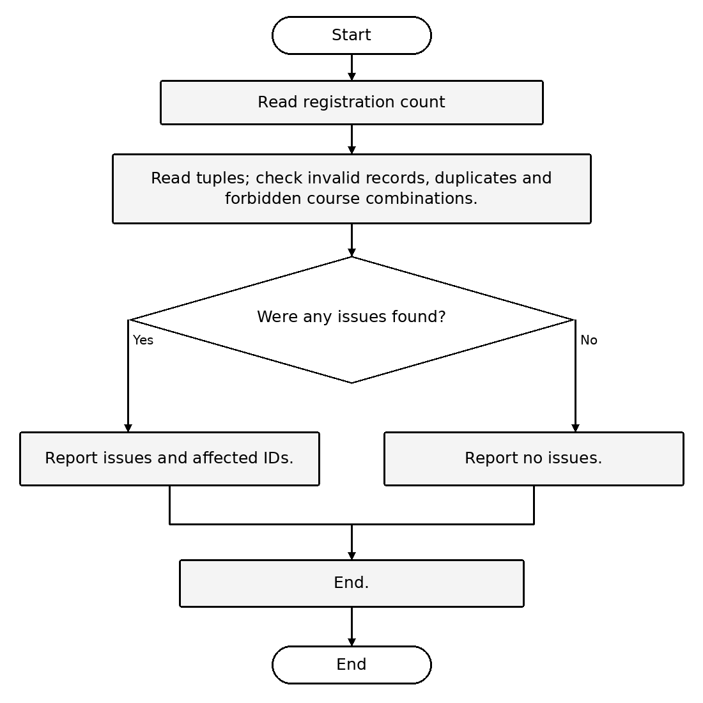

# Case 64: Tuple-Based Course Registration Validation

## Problem statement

Represent registrations as tuples, identify duplicate registrations and invalid course combinations, and determine students whose selections violate supplied rules.

## Objectives

- Store student-course pairs as tuples.
- Report duplicate registrations, disallowed combinations and affected students.

## Assumptions

- Valid course codes are PY, DB, AI and ML. Student IDs must be nonempty.
- AI and ML cannot both be selected by the same student under this example rule.
- Matching is case-insensitive for IDs and codes. A repeated student-course pair is a duplicate; invalid records also make their nonempty student ID affected.
- Numeric input must be entered in the requested format.

## Algorithm

1. Read the registrations as student ID and course code tuples.
2. Validate the ID and course, and detect previously seen pairs.
3. Build a list of student IDs and check each for the forbidden AI/ML combination.
4. Print each issue and the distinct affected student IDs, or report no issues.

## Flowchart



## Pseudocode

```text
READ registrations into a list of tuples
FOR each tuple
  UNPACK student and course
  CHECK fields and duplicate pair
  RECORD affected student when possible
FOR each student
  IF both AI and ML exist: report combination
PRINT affected students or no issues
```

## Python source code

[solution.py](solution.py)

## Test cases

1. **Duplicate and forbidden combination**

   Input (one value per line):

   ```text
4
s1
AI
s1
ML
s1
AI
s2
PY
   ```

   Expected: `Duplicate registration`; `Forbidden combination for S1`; `Affected students: S1`.

2. **Valid registrations**

   Input (one value per line):

   ```text
2
s1
PY
s2
ML
   ```

   Expected: `No registration issues`.

3. **Invalid course**

   Input (one value per line):

   ```text
1
s3
XX
   ```

   Expected: `Invalid registration`; `Affected students: S3`.

4. **Empty student ID**

   Input (one value per line):

   ```text
1

PY
   ```

   Expected: `Invalid registration`; `No identifiable affected student`.

## Output screenshots

- Test 1: [output image](output-1.png) | [output text](output-1.txt)
- Test 2: [output image](output-2.png) | [output text](output-2.txt)
- Test 3: [output image](output-3.png) | [output text](output-3.txt)
- Test 4: [output image](output-4.png) | [output text](output-4.txt)

The images are made from actual captured program output; input is shown separately.

## Conclusion

The program solves this case using the rules and conditions stated above.
